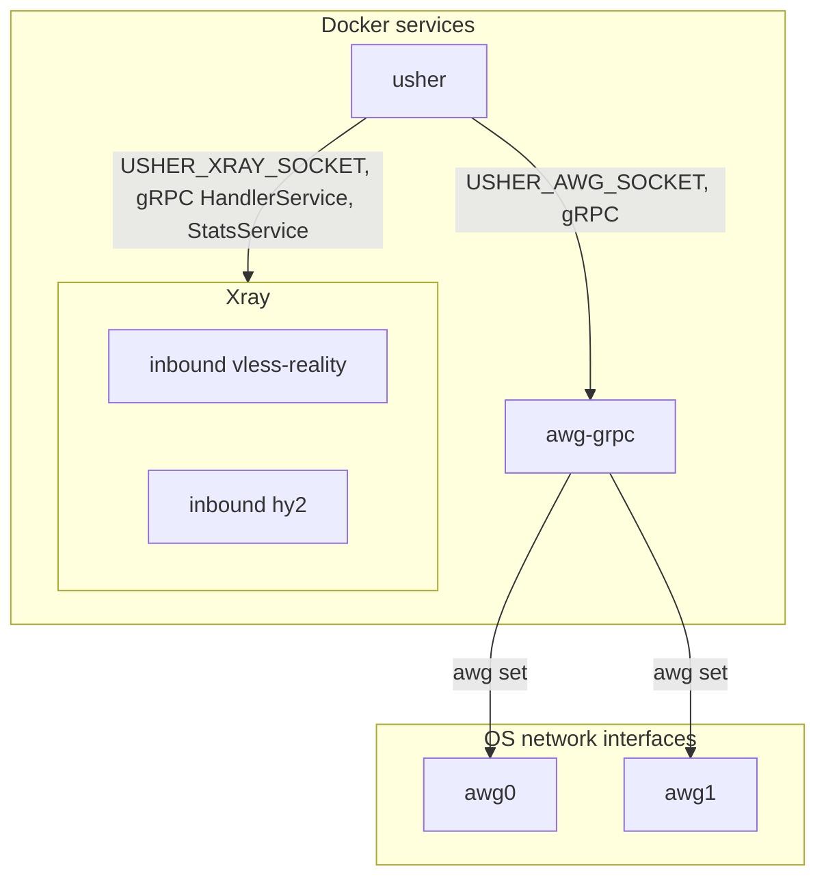

# usher

[](https://github.com/mrcsin/usher/actions/workflows/ci.yml?query=branch%3Amaster+event%3Apush)
[](LICENSE)

<div align="center">
    
</div>

User management for the VPN services of one node. You list users and the interfaces each may use
in one file; a few seconds after you save it, usher creates their keys, puts them into the running
services and writes a ready client config per user and interface. Addresses and keys stay
internal: you type names only. An interface is an AmneziaWG interface or an inbound of your Xray
config.

usher holds no capabilities and is never in the packet path. Every VPN service runs in its own
container with a small management API on a unix socket; usher calls that API and nothing else, so
a crash or an upgrade of usher leaves every session running. AmneziaWG is supported through
[awg-grpc](https://github.com/mrcsin/awg-grpc), Xray through its own gRPC API.

## How it fits together



usher drives one awg-grpc and one Xray: each variable names one socket. One awg-grpc carries any
number of AmneziaWG interfaces, one Xray any number of inbounds, and every name you put in
`usher.yml` is one of them.

The socket is the only control channel, and it has no authentication: any process that can open
it controls every peer or user of that service. Each service creates its socket with mode `0660`,
so usher must belong to the socket's group to open it. The usher image runs as uid and gid 1000,
and the example compose file gives both sockets that group.

Through the sockets usher owns every interface awg-grpc reports and every Xray inbound with a tag
and a supported protocol: it removes any peer or user that `usher.yml` does not list.

## Users

usher keeps everything under `/srv/usher` in its container; the example compose file mounts the
four directories:

```
/srv/usher/
├── config/usher.yml                  you write it, usher only reads it
├── state/users.json                  usher writes it, back it up
├── clients/<user>/<interface>.<ext>  usher writes it, hand the files to the users
└── status/usher.prom                 usher writes it with USHER_STATUS_DIR set, see Stats
```

`config/usher.yml`:

```yaml
alice-phone: [awg0]
alice-laptop: [awg0, vless-reality]
bob: []
```

- Give each device its own name.
- A user name has up to 32 lowercase letters, digits, `_` and `-`, and starts with a letter or a
  digit.
- Removing a name, or setting it to `[]`, switches the user off. The keys stay, and putting the
  name back restores the same config.
- usher checks the file at every change: YAML syntax, the name rules, no user or interface listed
  twice, and at least one user with an interface, so a truncated file cannot switch everyone off.
  A file that fails changes nothing: usher logs the error with its line and keeps the last valid
  file in memory, through any number of failed saves in a row. It never writes `usher.yml`. After
  a restart there is no earlier valid file, so usher logs and does nothing until the file is
  valid.
- awg-grpc and Xray hold no user state: a restart of either starts it empty. usher holds all of
  it in `state/users.json` and puts the users back within 30 s.

For this file `clients/` holds:

```
clients/
├── alice-phone/
│   └── awg0.conf
└── alice-laptop/
    ├── awg0.conf
    ├── vless-reality.json
    └── vless-reality.txt
```

`state/users.json` is the only copy of every key, so keep the state volume in the backup set.
[`docs/operations.md`](docs/operations.md) covers client isolation, DNS and new keys for a user.

## Running

[`deploy/compose.example.yml`](deploy/compose.example.yml) runs usher next to awg-grpc and Xray.
With one backend, delete the other service and its socket variables from the file. Images are
`ghcr.io/mrcsin/usher:<version>`, such as `v0.2.0`.

| Variable            | Required                 | Example                  | Meaning                                          |
| ------------------- | ------------------------ | ------------------------ | ------------------------------------------------ |
| `USHER_HOST`        | yes                      | `203.0.113.10`           | IPv4 address clients connect to, not a host name |
| `USHER_AWG_SOCKET`  | one of the two sockets   | `/run/awg-grpc/awg.sock` | awg-grpc socket; enables AmneziaWG               |
| `USHER_DNS`         | with `USHER_AWG_SOCKET`  | `1.1.1.1,1.0.0.1`        | DNS servers in AmneziaWG configs                 |
| `USHER_XRAY_SOCKET` | one of the two sockets   | `/run/xray/api.sock`     | Xray API socket; enables Xray                    |
| `USHER_XRAY_CONFIG` | with `USHER_XRAY_SOCKET` | `/etc/xray/config.json`  | Xray server config, read-only                    |
| `USHER_STATUS_DIR`  | no                       | `/srv/usher/status`      | directory of `usher.prom`, see [Stats](#stats)   |

`USHER_AWG_SOCKET`, `USHER_XRAY_SOCKET`, `USHER_XRAY_CONFIG` and `USHER_STATUS_DIR` are absolute
paths inside the usher container.

`USHER_HOST` is an address because a client resolves a host name through its DNS server, which
sits inside the tunnel. When the tunnel drops, the client cannot resolve the name and does not
reconnect.

Besides the sockets, every deployment gives usher read access to the Xray config file and
publishes each interface port on the same host port, because client configs carry the port of the
interface. usher itself listens on no port. The comments in the example compose file carry the
rest of the wiring.

## AmneziaWG

An interface is a `<name>.conf` file of awg-grpc; usher manages its peers only. A user gets the
lowest free address of the interface's IPv4 subnet, an X25519 key pair and a preshared key. The
client `.conf` carries that address, `USHER_DNS`, the obfuscation parameters of the interface and
`USHER_HOST` with the interface port as the endpoint. An interface holds at most 1000 users.

## Xray

You write the Xray server config, and usher fills its inbounds with users. An inbound tag is the
interface name in `usher.yml`. usher puts users into the running inbounds through Xray's
`HandlerService` and never writes the config. The `.json` client config runs a local socks proxy
on 127.0.0.1:10808 and an http proxy on 127.0.0.1:10809; the `.txt` file is a share link.
[`docs/xray.md`](docs/xray.md) covers the server config contract, the supported shapes, the
`x-usher` block, TLS trust, client compatibility and config edits.

## Stats

With `USHER_STATUS_DIR` set, usher writes `usher.prom` into that directory after every pass, in the
Prometheus text format. node_exporter's textfile collector serves it; usher opens no port for it.
Each pass replaces the whole file, so it holds the last pass only, and Prometheus keeps the
history. Without the variable usher writes no file. [`docs/operations.md`](docs/operations.md)
covers the node_exporter setup, and Xray needs the stats switches of
[`docs/xray.md`](docs/xray.md#stats).

| Metric                            | Labels              | Value                                         |
| --------------------------------- | ------------------- | --------------------------------------------- |
| `usher_interface_up`              | `interface`         | 1 when the last pass applied the interface, 0 when it failed it |
| `usher_user_online`               | `interface`, `user` | 1 when the user is connected now              |
| `usher_user_uplink_bytes_total`   | `interface`, `user` | bytes received from the user                  |
| `usher_user_downlink_bytes_total` | `interface`, `user` | bytes sent to the user                        |

Both backends write the same metrics; only the `interface` value tells them apart. Their values
mean different things:

|                  | AmneziaWG                                          | Xray                                             |
| ---------------- | -------------------------------------------------- | ------------------------------------------------ |
| online           | a handshake less than 180 s ago: 1 while the tunnel is up, 0 up to 180 s after the client disconnects | at least one open proxied connection; an idle client reads 0 |
| bytes            | encrypted packets, keepalives included             | proxied payload                                  |
| counters reset   | when the peer is recreated or the interface restarts | when Xray restarts                             |
| users in the file | users of the interface in `usher.yml` that have a peer | every user of the inbound in `usher.yml`     |

`rate()` and `increase()` handle the counter resets. A user gets series only on the interfaces
`usher.yml` lists for that user. When usher cannot read the stats of an interface, it logs
`reading stats` and leaves the users of that interface out of the file: a missing series
means unknown, and usher never writes 0 for a value it could not read. An interface that failed
before `Apply` has no user series. The interfaces of a backend that is down are absent.

usher keeps no last-seen value. Prometheus derives it from `usher_user_online`; this query gives the
time of the last sample with value 1 in the last 30 days:

```promql
max_over_time((timestamp(usher_user_online == 1))[30d:1m])
```

## License

[MIT](LICENSE)
